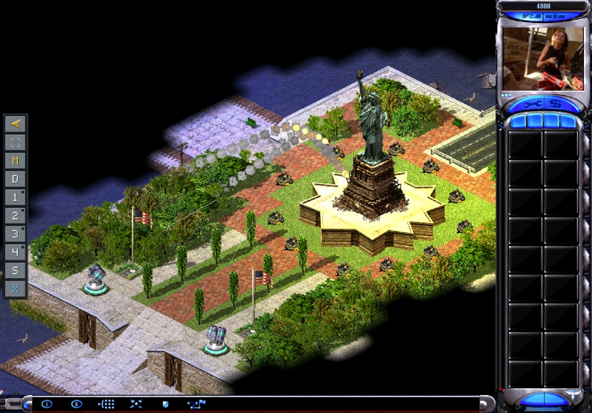
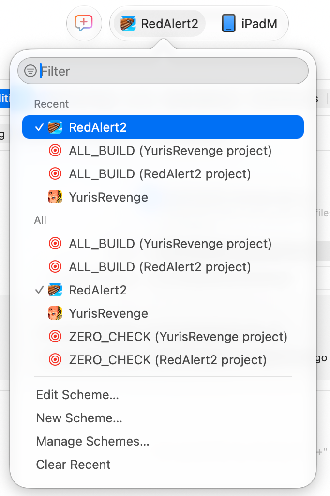
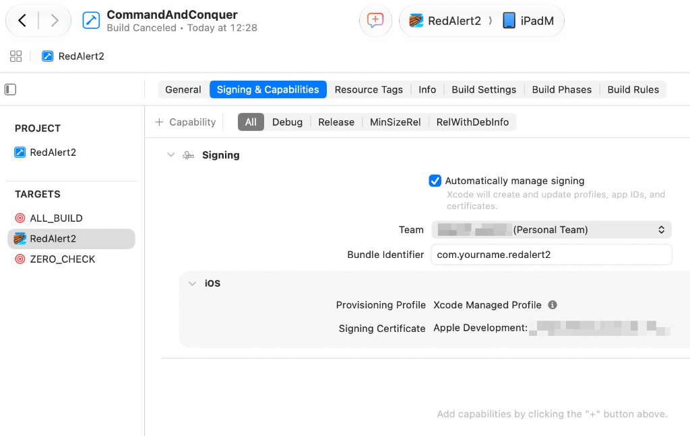
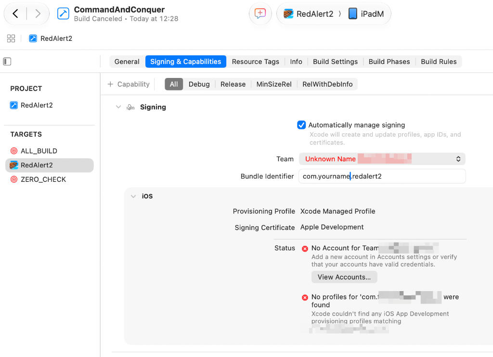

# Command & Conquer: Red Alert 2 & Yuri's Revenge
### Native iPadOS & iOS Port (`arm64`)

> *"Welcome back, Commander."*

<p align="center">
  
</p>

A native static AOT (ahead-of-time) C recompilation and touch port of Westwood Studios' legendary RTS classics **Command & Conquer: Red Alert 2** (v1.006) and **Yuri's Revenge** (v1.001) for **iPadOS and iOS** on Apple Silicon (`arm64`).

Runs at native speed (60 FPS) with hardware-accelerated Metal/SDL2 graphics, modern widescreen rendering, virtual on-screen keyboard support, and a complete retro-modern tactical touch HUD.

---

## 🌟 Highlights & Features

- **100% Native Apple Silicon Execution:** Ahead-of-time (AOT) recompiled static C code (48,000+ native functions) coupled with a clean Win32 high-level emulation (HLE) layer. Zero emulation overhead.
- **Dual Campaign & Skirmish Support:** Both *Red Alert 2* and *Yuri's Revenge* are fully playable with campaigns, skirmish mode, and map expansions.
- **Tailored Touch Controls & Tactical HUD:**
  - Single-finger tap: Select unit, command move, or attack.
  - Single-finger drag: Selection box / multi-unit grouping.
  - Two-finger drag: Smooth battlefield panning.
  - Virtual On-Screen Keyboard: Seamless text input for player names, save files, and Westwood edit controls.
  - Tactical Sidebar: Optimized touch target sizes, quick-build tabs, and full radar minimap integration.
- **Widescreen & High Performance:** Native resolution rendering with dynamic viewport patching and 60 FPS frame pacing.
- **Self-Contained App Bundles:** Game assets, mix archives, taunts, movies, and music are embedded directly inside the `.app` bundle.
- **Zero-Friction One-Click Setup:** Built-in interactive setup assistant (`python3 setup.py`) that checks your environment, downloads game files directly from Steam, configures code signing, and generates ready-to-run Xcode workspaces.

---

## 📋 Prerequisites

To build and install the port onto your iPad or iPhone, you will need:

1. **Mac computer:** Running macOS Sonoma or Sequoia with Apple Silicon (M1/M2/M3/M4 or newer).
2. **Xcode 16+:** Installed from the Mac App Store or Apple Developer portal.
   - Command Line Tools configured: `sudo xcode-select -s /Applications/Xcode.app/Contents/Developer`
   - License accepted: `sudo xcodebuild -license accept`
3. **CMake:** Installed via Homebrew (`brew install cmake`).
4. **Steam Account:** An account that owns *Command & Conquer: Red Alert 2 and Yuri's Revenge* (App ID `2229850`).
5. **iPad or iPhone:** Running iOS/iPadOS 16+ with **Developer Mode** enabled (*Settings → Privacy & Security → Developer Mode*).

---

## 🚀 Quick Start (Automated Setup)

Clone the repository and run the setup assistant:

```bash
git clone https://github.com/MargeLenders/redalert2-ipad.git
cd redalert2-ipad

python3 setup.py
```

### What `setup.py` does automatically:
1. **Environment Verification:** Validates `cmake`, `clang`, Xcode iOS SDKs (`iphoneos` and `iphonesimulator`), and arm64 precompiled dependencies (`SDL2`, `FreeType`, `FFmpeg`).
2. **Steam Game Asset Acquisition:** Downloads official Windows game files directly from Valve via official `SteamCMD` into `ra2-files/` and verifies PE timestamps and checksums.
3. **Recompiled C Validation:** Validates the static C code base (over 48,000 recompiled routines).
4. **Code Signing Assistant:** Detects your Apple Developer ID or Personal Team in Keychain for automatic signing.
5. **CMake Project Generation:** Generates `RedAlert2.xcodeproj` and `YurisRevenge.xcodeproj` with performance-optimized schemes.
6. **Unified Workspace:** Creates `CommandAndConquer.xcworkspace` and opens it in Xcode.

---

## 🛠️ Compiling & Deploying to iPad

1. In **Xcode**, open `CommandAndConquer.xcworkspace`.
2. Select your target scheme from the top bar:
   - **`RedAlert2`** for Allied & Soviet campaigns and classic skirmish.
   - **`YurisRevenge`** for Yuri's Revenge campaign and expansion units.
3. Change the run destination from *Any iOS Device* to your **connected physical iPad**.

<p align="center">
  
</p>

4. Check the **Signing & Capabilities** tab:
   - Ensure **Automatically manage signing** is checked.
   - Select your **Team** (e.g. `Your Name (Personal Team)`).
   - If prompted, customize the **Bundle Identifier** to ensure uniqueness (e.g. `com.yourname.redalert2`).
   - Verify that **Provisioning Profile** shows `Xcode Managed Profile` without any red error indicators.

<p align="center">
  
</p>

5. Click **▶ Run** (`Cmd + R`). Xcode will compile, package, sign, and install the game on your iPad.

---

### 🔧 Troubleshooting Code Signing ("The executable is not codesigned")

If Xcode fails during deployment with an alert saying *"The executable is not codesigned"*, check the **Signing & Capabilities** tab of your target.

<p align="center">
  
</p>

**Common causes & fixes:**
- **Unknown / Mismatched Team:** If the Team dropdown shows a red `Unknown Name (...)` or `No Account for Team`, open the dropdown and choose your active **Personal Team** associated with your Apple ID.
- **Bundle Identifier Conflict:** If you see `No profiles for 'com....' were found`, change the **Bundle Identifier** to a globally unique string (for example, `com.<your-username>.redalert2`).
- Once resolved, Xcode will display **Provisioning Profile: Xcode Managed Profile** with no error badges, and clicking **▶ Run** will succeed.

---

## 📱 First-Time Launch on iPadOS

If deploying with a free personal Apple ID:
1. When you first tap the game icon on your iPad, iPadOS may show a *"Untrusted Developer"* dialog.
2. On your iPad, navigate to:
   **Settings → General → VPN & Device Management**
3. Under **Developer App**, tap your Apple ID email.
4. Tap **Trust "[Your Apple ID]"** and confirm.
5. Return to the Home Screen and launch **Red Alert 2** or **Yuri's Revenge**.

---

## 📂 Repository Structure

```
.
├── CMakeLists.txt                # Unified CMake build configuration
├── CommandAndConquer.xcworkspace # Multi-project Xcode workspace
├── setup.py                      # Interactive all-in-one setup assistant
├── cmake/                        # iOS arm64 device and simulator toolchains
├── deps/                         # Precompiled iOS arm64 libraries (SDL2, FreeType, FFmpeg)
│   ├── installed-ios/            # Physical device arm64 static libraries
│   └── installed-ios-sim/        # Simulator arm64 static libraries
├── docs/                         # Documentation assets and screenshots
│   └── images/                   # Visual setup and signing guides
├── packaging/                    # App assets, icons, launch screens, and Info.plists
│   └── ios/                      # Asset catalogs and platform configurations
├── recomp/                       # AOT recompiled static C sources
│   ├── gen_game/                 # Red Alert 2 recompiled code (v1.006)
│   └── gen_yr/                   # Yuri's Revenge recompiled code (v1.001)
├── src/                          # Native C++ engine, iOS bridge, touch HUD, Win32 HLE
│   ├── platform/ios/             # Metal/SDL2 display bridge, touch event router
│   ├── runtime/                  # Engine hooks, video playback, audio mixer
│   └── win32hle/                 # POSIX Win32 high-level emulation layer
└── tools/                        # Binary lifting, disassembler, and asset utilities
```

---

## ❓ Frequently Asked Questions (FAQ)

#### Does this require a paid Apple Developer account?
No. Free Apple IDs (Personal Teams) are fully supported. Note that apps signed with free accounts are valid for 7 days, after which re-running the project from Xcode refreshes the profile.

#### Can I play in the iOS Simulator?
Yes. Pass `--simulator` to `setup.py`:
```bash
python3 setup.py --simulator
```

#### Are game assets included in the repository?
No. To respect Electronic Arts' intellectual property, proprietary game data (`.mix` files, movies, and audio) is never tracked in git. The setup assistant downloads the official files via your own Steam account with SteamCMD.

---

## ☕ Support the Project

If you appreciate the effort put into porting Command & Conquer: Red Alert 2 & Yuri's Revenge to iPadOS and enjoy playing it natively on Apple Silicon, consider buying me a coffee to support future updates and maintenance!

<p align="center">
  <a href="https://www.buymeacoffee.com/margelenders" target="_blank">
    
  </a>
</p>

---

## ⚖️ Legal Disclaimer

This project is an independent educational and preservation effort and is not affiliated with, endorsed by, or sponsored by Electronic Arts Inc. or Valve Corporation. Command & Conquer, Red Alert, and Westwood Studios are trademarks or registered trademarks of Electronic Arts Inc. Game assets must be legally acquired via Steam.
